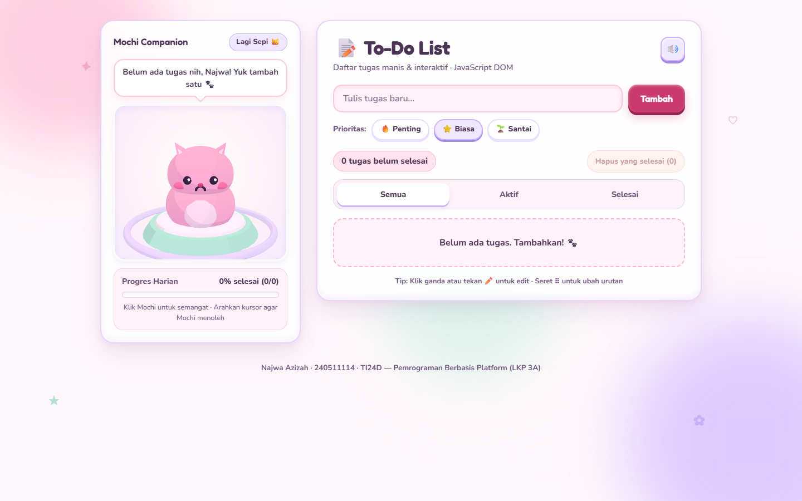
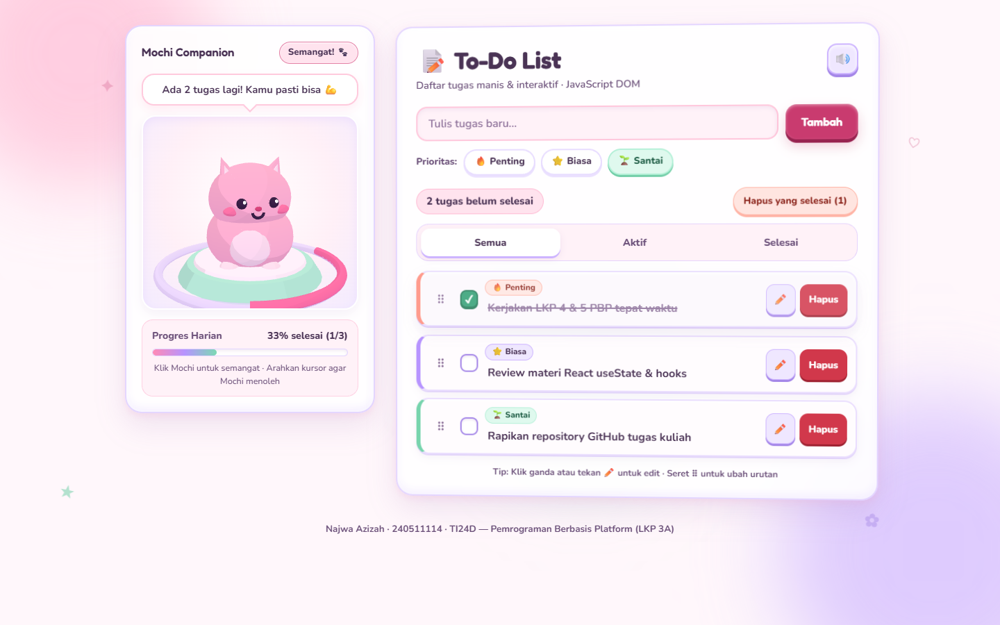
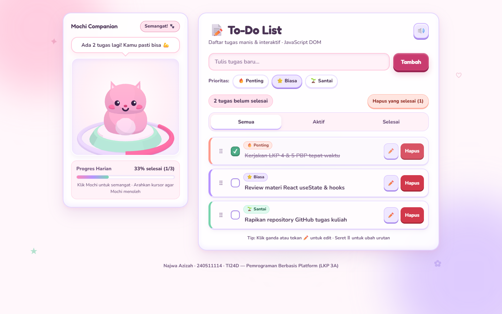
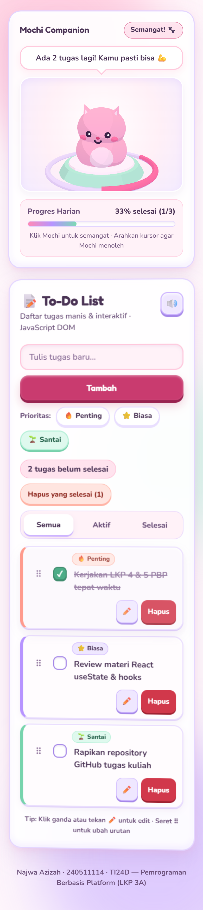

# LKP 3A — Aplikasi To-Do List dengan JavaScript Murni (3D Pastel Kawaii) 📝🐾

Tugas praktikum **Pertemuan 4: JavaScript Fundamentals & DOM** mata kuliah **Pemrograman Berbasis Platform** (Program Studi S1 Teknik Informatika, Universitas Muhammadiyah Cirebon).

## Identitas Mahasiswa
- **Nama**: Najwa Azizah
- **NIM**: 240511114
- **Kelas**: TI24D

---

## Tujuan Praktikum
Membangun aplikasi To-Do List interaktif menggunakan **JavaScript ES6+ murni**, manipulasi **DOM**, **Event Handling**, dan **`localStorage`**, yang diperkaya dengan antarmuka **Pastel Kawaii 3D Claymorphism** serta maskot interaktif **Mochi Cat 3D** berbasis Three.js.

---

## Struktur Folder

```text
lpk-3a/
├── index.html          # Struktur HTML5 semantik & elemen wajib modul (#form-todo, #input-todo, #stats, #list-todo)
├── style.css           # Design system pastel kawaii 3D claymorphism, responsif & aksesibel
├── app.js              # Logika state, DOM manipulation aman (tanpa XSS), drag & drop, confetti, audio
├── mascot.js           # Maskot Kucing Mochi 3D & cincin progres 3D (Three.js via CDN + fallback CSS)
├── README.md           # Dokumentasi project LKP 3A
└── screenshots/        # Dokumentasi hasil uji desktop & mobile
    ├── 01-kosong-desktop.png
    ├── 02-berisi-desktop.png
    ├── 03-setelah-refresh-desktop.png
    └── 04-berisi-mobile.png
```

---

## Fitur Utama

### 1. Fitur Wajib Modul (Rubrik Penilaian)
- **Tambah tugas (`tambahTodo`)**: Menambah tugas melalui form `#form-todo` (`submit` / tombol `Enter`) lengkap dengan pilihan prioritas.
- **Toggle selesai (`toggleSelesai`)**: Checkbox native mengubah status selesai/belum selesai dan tampilan coret (`line-through`).
- **Hapus tugas (`hapusTodo`)**: Tombol `Hapus` dengan animasi keluar halus sebelum menghapus item dari state.
- **Persistensi `localStorage`**: Data tugas tersimpan pada key `"todos"` (beserta status mute pada `"todos-muted"`) sehingga tetap ada setelah halaman di-refresh.
- **Statistik tugas (`#stats`)**: Menampilkan jumlah `"X tugas belum selesai"` secara real-time.

### 2. Fitur 3D, Interaktif & Aksesibilitas
- **Maskot Kucing Mochi 3D (`mascot.js`)**:
  - Berkala berkedip otomatis dan menoleh mengikuti posisi pointer.
  - Berekspresi sedih (`Lagi Sepi 😿`) saat kosong, menyemangati (`Semangat! 🐾`) saat ada tugas aktif, serta tersenyum dengan bintang mengorbit (`Hore! Beres 🌸`) saat seluruh tugas selesai.
  - Melompat & berputar saat tugas diselesaikan, dan memantul (*squish*) disertai pesan penyemangat acak saat diklik.
  - Dilengkapi **Cincin Progres 3D** (*TorusGeometry*) di sekeliling alas mint yang terisi sesuai persentase penyelesaian.
- **Filter & Manajemen Daftar**: Filter `Semua`, `Aktif`, dan `Selesai` (`aria-pressed`), tombol `Hapus yang selesai (n)`, serta stiker prioritas (`🔥 Penting`, `⭐ Biasa`, `🌱 Santai`).
- **Edit Inline (`editTodo`)**: Klik ganda teks tugas atau klik tombol `✏️` (`Enter` / *blur* untuk simpan, `Esc` untuk batal).
- **Urutkan Tugas (`pindahTodo`)**: Drag & drop menggunakan Pointer Events lewat pegangan `⠿`, serta dukungan keyboard (`ArrowUp` / `ArrowDown`) saat filter pada posisi `Semua`.
- **Confetti & Efek Suara**: Partikel confetti pastel + suara *pop* WebAudio saat tugas selesai (dapat di-mute melalui tombol `🔊` / `🔇`).
- **Aksesibilitas & Keamanan**: Rendering DOM menggunakan `createElement` + `textContent` (bebas XSS), target sentuh memadai, `:focus-visible`, dan menghormati `prefers-reduced-motion`.

---

## Cara Menjalankan

1. **Langsung di Browser**:
   Buka file `index.html` langsung di Chrome / Edge / Firefox.
2. **Atau lewat HTTP Server Lokal**:
   ```bash
   cd lpk-3a
   python -m http.server 5174
   ```
   Lalu buka `http://localhost:5174/` di browser.

> **Catatan Teknis**:
> - `mascot.js` dimuat sebagai script klasik dan mengimpor Three.js (`three@0.170.0`) secara dinamis melalui `import("https://cdn.jsdelivr.net/npm/three@0.170.0/build/three.module.js")` agar tetap berjalan mulus meskipun dibuka lewat protokol `file://`.
> - Membutuhkan koneksi internet untuk memuat Three.js dan Google Fonts (`Fredoka` & `Nunito`). Bila sedang offline atau WebGL tidak tersedia, aplikasi tetap berfungsi penuh dengan maskot fallback CSS (`🐱`).

---

## Screenshot Pengujian

| Kondisi Kosong (Desktop 1440×900) | Berisi 3 Tugas & 1 Selesai (Desktop) |
| :---: | :---: |
|  |  |

| Setelah Refresh — Data Persist (Desktop) | Tampilan Responsif (Mobile 390×844) |
| :---: | :---: |
|  |  |
